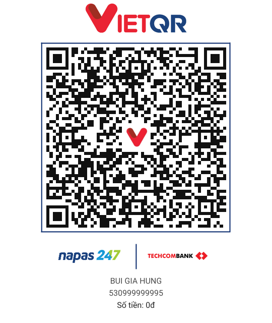

# ☕ Ủng hộ tác giả (Donate)

Cảm ơn bạn đã dùng **ctrlf**! Nếu nó giúp bạn tiết kiệm token, tiền API hoặc chỉ đơn giản là tiết kiệm thời gian — mời bạn ủng hộ tác giả một ly cà phê ☕

---

## 🌍 Quốc tế (International)

Thanh toán qua Visa/Mastercard hoặc PayPal. Không cần tài khoản đặc biệt.

---

## 🇻🇳 Việt Nam — Chuyển khoản nội địa (VietQR)

> **Quét mã QR bên dưới hoặc chuyển khoản thủ công:**

<!-- 
  HƯỚNG DẪN TÁC GIẢ:
  1. Vào https://vietqr.io/
  2. Chọn ngân hàng + nhập số tài khoản + tên + số tiền gợi ý
  3. Tải ảnh QR về, đặt vào assets/vietqr.png
  4. Xóa comment này và bỏ comment phần  bên dưới
-->

<!--

  

-->

**Thông tin chuyển khoản:**

| Trường | Thông tin |
|---|---|
| Ngân hàng | *(Bạn điền tên ngân hàng)* |
| Số tài khoản | *(Bạn điền số tài khoản)* |
| Tên tài khoản | *(Bạn điền tên)* |
| Nội dung CK | `Ung ho ctrlf` |

> 💡 **Cách tạo QR VietQR nhanh:** vào [vietqr.io](https://vietqr.io/) → chọn ngân hàng → nhập số TK → tải ảnh QR → thay vào `assets/vietqr.png`

---

## 💌 MoMo

Gửi tiền qua MoMo bằng số điện thoại:  
> *(Bạn điền số điện thoại MoMo)*

---

*Mọi khoản ủng hộ dù nhỏ đều có ý nghĩa rất lớn và giúp tác giả có thêm động lực phát triển dự án. Cảm ơn bạn! 🙏*
